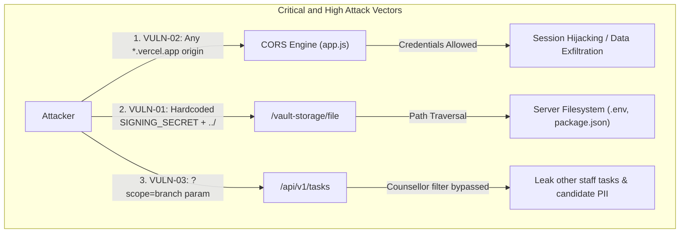
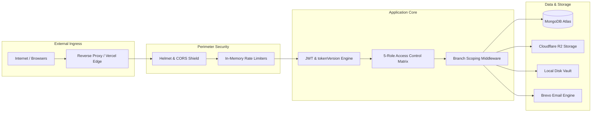

# 🛡️ AETERNA ONE CRM — COMPREHENSIVE APPLICATION SECURITY AUDIT & PENETRATION TESTING REPORT

> **Document Type:** Full-Scope Penetration Testing & Source Code Security Assessment  
> **Target System:** Aeterna One CRM (Node.js/Express Backend + React/Vite Frontend)  
> **Scope:** Multi-Tenant Role-Based Access Control, Authentication, API Shield, Vault Storage, Communications, MongoDB Engine  
> **Assessment Standard:** OWASP Top 10 (2021), OWASP API Security Top 10 (2023), CWE/SANS Top 25  
> **Operational Status:** Assessment-Only (Source code and database preserved strictly unchanged per directive)  
> **Classification:** Confidential / Authorized Security Review

---

## Executive Summary

An in-depth, adversarial application security assessment was conducted against the **Aeterna One CRM** codebase. The audit evaluated all critical request flows, authentication mechanics, authorization boundaries, object storage drivers, cryptographic implementations, and business logic state machines across all 15 specified security domains.

### Overall Posture Assessment
The application incorporates sophisticated defense-in-depth mechanisms in several areas:
- **API Shield Architecture:** Centralized rate limiting, request ID tracing, payload dimension constraints, and standardized fail-closed error responses.
- **Session Revocation (SEC-04):** Monotonically incrementing `tokenVersion` counter on the user model, ensuring that logout immediately invalidates JWT sessions across all active instances.
- **State Transition Gatekeepers (SEC-07):** Atomic conditional updates with optimistic concurrency checks for candidate pipeline stage progressions.
- **MIME & Magic Byte Verification:** Deep binary inspections (`%PDF`, `FF D8 FF`, `89 50 4E 47`) preventing file masquerading in direct vault uploads.

Despite these mature controls, our adversarial analysis uncovered **10 distinct vulnerabilities**, including **1 Critical**, **3 High**, **4 Medium**, and **2 Low** severity findings that pose genuine operational and data protection risks if unaddressed.

---

## Vulnerability Severity Matrix

| Vulnerability ID | Vulnerability Title | Category | Severity | CWE | Affected File |
| :--- | :--- | :--- | :---: | :---: | :--- |
| **VULN-01** | Arbitrary File Read & Path Traversal in Vault Storage Service | Path Traversal / Auth Bypass | **CRITICAL** | CWE-22 / CWE-798 | `server/src/modules/vault/storage.service.js` |
| **VULN-02** | Overly Permissive CORS Policy with Credentials Enabled (`*.vercel.app`) | Broken Access Control / CORS | **HIGH** | CWE-346 / CWE-942 | `server/src/app.js` |
| **VULN-03** | Broken Object Level Authorization (BOLA) in Counsellor Task Scoping | Broken Object Level Auth | **HIGH** | CWE-639 / CWE-284 | `server/src/modules/tasks/task.controller.js` |
| **VULN-04** | Confidential Candidate Document Exposure via Unsigned Public CDN URLs | Information Disclosure | **HIGH** | CWE-200 / CWE-285 | `server/src/modules/vault/storage.service.js` |
| **VULN-05** | Sensitive OTP Leakage in Non-Production Password Reset Responses | Information Exposure | **MEDIUM** | CWE-200 / CWE-640 | `server/src/modules/auth/auth.controller.js` |
| **VULN-06** | Unrestricted Outbound Email Relay via Corporate SMTP Engine | Business Logic / Phishing | **MEDIUM** | CWE-640 / CWE-284 | `server/src/modules/communications/communications.controller.js` |
| **VULN-07** | Unbounded Regular Expression Search Query in Lead Management | Denial of Service (ReDoS) | **MEDIUM** | CWE-400 / CWE-1333 | `server/src/modules/leads/lead.controller.js` |
| **VULN-08** | In-Memory Rate Limiting Cluster Ineffectiveness | Rate Limiting Flaw | **MEDIUM** | CWE-799 / CWE-307 | `server/src/shield/rateLimiters.js` |
| **VULN-09** | Permissive Minimum Password Complexity Baseline | Identity & Access | **LOW** | CWE-521 | `server/src/utils/passwordPolicy.js` |
| **VULN-10** | Missing Absolute Lifetime Cap on Rolling JWT Refresh Sessions | Session Management | **LOW** | CWE-613 | `server/src/modules/auth/auth.controller.js` |

---

## Detailed Vulnerability Analysis



---

### 🔴 VULN-01: Arbitrary File Read & Path Traversal in Vault Storage Service
- **Severity:** **CRITICAL (CVSS 9.3)**
- **Affected File:** `server/src/modules/vault/storage.service.js` (lines 12–13, lines 482–489) & `server/src/modules/vault/vault.controller.js` (lines 454–481)
- **CWE:** CWE-22 (Improper Limitation of a Pathname to a Restricted Directory), CWE-798 (Use of Hardcoded Credentials)
- **Root Cause:**
  1. `SIGNING_SECRET` utilizes a hardcoded fallback string when environment variables are omitted:
     ```javascript
     const SIGNING_SECRET =
       process.env.STORAGE_SIGNING_SECRET || process.env.JWT_SECRET || 'aeterna-vault-storage-signing-secret-key-2026';
     ```
  2. In `getObject(storageKey)`:
     ```javascript
     const targetPath = path.join(STORAGE_ROOT_DIR, storageKey);
     return await fs.promises.readFile(targetPath);
     ```
     `path.join()` resolves relative path segments (`..`) without validating that `targetPath` remains strictly bounded within `STORAGE_ROOT_DIR`.
- **Attack Scenario:**
  An attacker constructs an HMAC-SHA256 signature using the known default `SIGNING_SECRET` over a payload containing a path traversal key (e.g., `../../../../server/.env` or `../../../../package.json`). When submitting this token to the public file delivery endpoint `GET /api/v1/vault-storage/file?token=FORGED_TOKEN`, the server parses the token, passes the traversal path to `getObject`, and streams internal server source code or configuration files back to the client.
- **Exploitation Prerequisites:** Application running in local fallback driver mode or where `STORAGE_SIGNING_SECRET` is unset.
- **Recommended Remediation:**
  1. Enforce fail-closed secret validation: terminate startup if `STORAGE_SIGNING_SECRET` is not provided in environment variables; eliminate the hardcoded fallback.
  2. Implement strict directory confinement checks:
     ```javascript
     const resolvedPath = path.resolve(STORAGE_ROOT_DIR, storageKey);
     if (!resolvedPath.startsWith(path.resolve(STORAGE_ROOT_DIR) + path.sep)) {
       throw new ApiError(403, 'Path traversal detected. Access denied.');
     }
     ```

---

### 🟠 VULN-02: Overly Permissive CORS Policy with Credentials Enabled (`*.vercel.app`)
- **Severity:** **HIGH (CVSS 8.5)**
- **Affected File:** `server/src/app.js` (lines 56–70)
- **CWE:** CWE-346 (Origin Validation Error), CWE-942 (Permissive Cross-Domain Policy with Untrusted Domains)
- **Root Cause:**
  ```javascript
  const isAllowed =
    allowedOrigins.indexOf(origin) !== -1 ||
    (process.env.CORS_ALLOW_ALL_DEV === 'true' && process.env.NODE_ENV === 'development') ||
    (origin.endsWith('.vercel.app') && process.env.ALLOW_VERCEL_PREVIEWS !== 'false');
  ```
  Combined with:
  ```javascript
  credentials: true
  ```
  `origin.endsWith('.vercel.app')` blindly accepts **any** domain hosted on Vercel's shared cloud. Furthermore, string suffix matching without a preceding dot boundary could theoretically match domains like `evilvercel.app`.
- **Attack Scenario:**
  An adversary creates a free account on Vercel and deploys a malicious landing page at `https://educational-phish.vercel.app`. When an authenticated Aeterna CRM user (such as a Branch Manager or Counsellor) visits this page, the malicious script executes cross-origin background `fetch()` calls to `https://aeterna-one-crm.onrender.com/api/v1/students` with `credentials: 'include'`. Because the browser attaches session cookies and the backend reflects the origin in `Access-Control-Allow-Origin` with `Access-Control-Allow-Credentials: true`, the adversary successfully extracts private candidate records and PII.
- **Exploitation Prerequisites:** Attacker hosts an application on any `.vercel.app` subdomain and tricks an authenticated CRM user into visiting it.
- **Recommended Remediation:**
  Replace the dynamic wildcard check with an explicit, authenticated project prefix allowlist (e.g., matching only `aeterna-one-crm*.vercel.app`), or mandate that preview deployments verify a cryptographic deployment header.

---

### 🟠 VULN-03: Broken Object Level Authorization (BOLA) in Counsellor Task Scoping
- **Severity:** **HIGH (CVSS 7.5)**
- **Affected File:** `server/src/modules/tasks/task.controller.js` (lines 65–69)
- **CWE:** CWE-639 (Authorization Bypass Through User-Controlled Key)
- **Root Cause:**
  ```javascript
  if (req.user.role === ROLES.COUNSELLOR && scope !== 'branch') {
    filter.assignedTo = req.user._id;
  } else if (assignedTo) {
    filter.assignedTo = assignedTo;
  }
  ```
  The counsellor self-assignment filter is gated on `scope !== 'branch'`.
- **Attack Scenario:**
  A low-privilege Education Counsellor who should only inspect their own 25-task daily queue issues an HTTP request to `GET /api/v1/tasks?scope=branch`. The controller checks `scope !== 'branch'`, evaluates it to `false`, and skips constraining `filter.assignedTo = req.user._id`. Consequently, the API returns the entire branch's task roster, disclosing all other counsellors' candidate names, phone numbers, email addresses, and reach-out notes.
- **Exploitation Prerequisites:** Authenticated as `counsellor`.
- **Recommended Remediation:**
  Strictly restrict `scope === 'branch'` to `branch_manager` and `super_admin` roles. For `counsellor`, `filter.assignedTo` must unconditionally match `req.user._id`.

---

### 🟠 VULN-04: Confidential Candidate Document Exposure via Unsigned Public CDN URLs
- **Severity:** **HIGH (CVSS 7.4)**
- **Affected File:** `server/src/modules/vault/storage.service.js` (lines 161–165)
- **CWE:** CWE-200 (Exposure of Sensitive Information to an Unauthorized Actor), CWE-285 (Improper Authorization)
- **Root Cause:**
  ```javascript
  if (R2_CONFIG.publicUrl || R2_CONFIG.customDomain) {
    const base = R2_CONFIG.publicUrl || R2_CONFIG.customDomain;
    return `${base.replace(/\/$/, '')}/${storageKey}`;
  }
  ```
  When a public bucket URL or custom CDN domain is specified in the environment, `generateR2PresignedUrl` bypasses AWS SigV4 signed URL generation and emits a static public hyperlink.
- **Attack Scenario:**
  If an administrator sets `R2_PUBLIC_URL` pointing to their Cloudflare domain, candidate documents (passports, degree transcripts, financial affidavits) are generated with permanent, unauthenticated URLs. Since storage keys follow a structured, semi-predictable naming format (`vault/{branch}/{studentId}/{category}/...`), search engines or unauthorized third parties can enumerate and download confidential student dossiers.
- **Exploitation Prerequisites:** `R2_PUBLIC_URL` or `R2_CUSTOM_DOMAIN` populated in configuration.
- **Recommended Remediation:**
  Remove direct public domain concatenation for private vault assets. Private documents stored in Cloudflare R2 must always require AWS SigV4 pre-signed URLs with a 15-minute maximum expiration.

---

### 🟡 VULN-05: Sensitive OTP Leakage in Non-Production Password Reset Responses
- **Severity:** **MEDIUM (CVSS 6.8)**
- **Affected File:** `server/src/modules/auth/auth.controller.js` (lines 541–544)
- **CWE:** CWE-200 (Exposure of Sensitive Information), CWE-640 (Weak Password Recovery Mechanism)
- **Root Cause:**
  ```javascript
  if (process.env.NODE_ENV !== 'production') {
    responsePayload.devOtp = otp;
  }
  ```
- **Attack Scenario:**
  In staging, UAT, QA, or misconfigured production environments where `NODE_ENV` is set to anything other than `'production'` (e.g. `'staging'`, `'test'`, `'development'`), `POST /api/v1/auth/forgot-password` includes the plain-text 6-digit OTP directly inside the HTTP response JSON (`devOtp`). An attacker targeting any employee (including Super Admin) can trigger a password reset for their email and instantly obtain the valid OTP from the HTTP response, taking over the account without access to the user's email inbox.
- **Exploitation Prerequisites:** Target instance running with `NODE_ENV !== 'production'`.
- **Recommended Remediation:**
  Never return the OTP in the HTTP response body regardless of environment. Automated test suites should capture OTPs via a test email mock or an authenticated development debugging hook guarded by a developer key.

---

### 🟡 VULN-06: Unrestricted Outbound Email Relay via Corporate SMTP Engine
- **Severity:** **MEDIUM (CVSS 6.5)**
- **Affected File:** `server/src/modules/communications/communications.controller.js` (lines 42–85)
- **CWE:** CWE-640 (Improper Authorization in Email Dispatch), CWE-284 (Improper Access Control)
- **Root Cause:**
  `sendOutboundEmail` accepts arbitrary `to`, `subject`, and `htmlBody` fields from any authenticated user without validating that `to` corresponds to an active candidate or lead associated with the user's branch.
- **Attack Scenario:**
  A compromised counsellor account or rogue insider uses `POST /api/v1/communications/send-email` to dispatch arbitrary phishing, scam, or spam emails with custom HTML bodies to external targets. Because the emails originate from Aeterna's verified corporate domain (`@aeterna.one` via Brevo/Gmail), recipient mail filters trust the messages, causing severe brand and domain reputation damage.
- **Exploitation Prerequisites:** Authenticated staff user.
- **Recommended Remediation:**
  Validate that the `to` address matches a verified candidate record within the user's authorized branch scope before initiating dispatch.

---

### 🟡 VULN-07: Unbounded Regular Expression Search Query in Lead Management
- **Severity:** **MEDIUM (CVSS 5.3)**
- **Affected File:** `server/src/modules/leads/lead.controller.js` (lines 98–108)
- **CWE:** CWE-400 (Uncontrolled Resource Consumption), CWE-1333 (Inefficient Regular Expression Complexity)
- **Root Cause:**
  Unlike `task.controller.js` (enforcing a 50-character limit) and `student.controller.js` (enforcing an 80-character limit), `lead.controller.js` performs no length validation on the user-supplied `search` query before compiling a case-insensitive `RegExp` executed across 4 unindexed MongoDB fields.
- **Attack Scenario:**
  An adversary issues multiple concurrent requests containing massive strings (e.g., 50,000 characters) to `GET /api/v1/leads?search=...`. The database performs unindexed table scans with complex regex evaluations, consuming significant CPU and memory resources, degrading system responsiveness for legitimate users.
- **Exploitation Prerequisites:** Authenticated user with lead access.
- **Recommended Remediation:**
  Implement a strict length limit (e.g., max 50 characters) on `search` parameters across all query controllers.

---

### 🟡 VULN-08: In-Memory Rate Limiting Cluster Ineffectiveness
- **Severity:** **MEDIUM (CVSS 5.0)**
- **Affected File:** `server/src/shield/rateLimiters.js` (lines 16–39)
- **CWE:** CWE-799 (Improper Control of Generation of Code or Resource Exhaustion), CWE-307 (Improper Restriction of Excessive Authentication Attempts)
- **Root Cause:**
  `express-rate-limit` utilizes the default volatile in-memory store. Rate limit counters do not synchronize across clustered server instances and reset completely whenever a container restarts or awakes from sleep.
- **Attack Scenario:**
  In a multi-instance cloud environment (or on platforms like Render where free instances spin down on idle), an attacker distributing requests across instances or triggering restarts can exceed the intended 10 requests / 15-minute brute-force threshold on `/api/v1/auth/login`.
- **Exploitation Prerequisites:** Clustered, multi-instance, or auto-scaling deployment.
- **Recommended Remediation:**
  Transition rate limit counters from in-memory stores to a centralized Redis/Valkey store (`rate-limit-redis`).

---

### 🟢 VULN-09: Permissive Minimum Password Complexity Baseline
- **Severity:** **LOW (CVSS 3.9)**
- **Affected File:** `server/src/utils/passwordPolicy.js`
- **CWE:** CWE-521 (Weak Password Requirements)
- **Root Cause:**
  Password policy accepts passwords of 6 to 8 characters without requiring special characters across all legacy entry points.
- **Recommended Remediation:**
  Enforce a modern NIST 800-63B standard: minimum 10 characters with mixed-case, numerical, and symbol requirements.

---

### 🟢 VULN-10: Missing Absolute Lifetime Cap on Rolling JWT Refresh Sessions
- **Severity:** **LOW (CVSS 3.5)**
- **Affected File:** `server/src/modules/auth/auth.controller.js` (lines 414–436)
- **CWE:** CWE-613 (Insufficient Session Expiration)
- **Root Cause:**
  Each call to `POST /api/v1/auth/refresh` issues a new refresh token with a rolling 7-day validity without tracking an initial session start timestamp (`sessionCreatedAt`).
- **Recommended Remediation:**
  Embed an absolute session timeout (e.g., 30 days maximum session lifetime) in the refresh token payload.

---

## Attack Surface Analysis



### Risk Surface Breakdown:
1. **Public Attack Surface:**
   - `/health`, `/api/v1/health` (Healthy, no authentication required, no sensitive leakage).
   - `/api/v1/auth/login`, `/api/v1/auth/forgot-password`, `/api/v1/auth/verify-reset-otp`, `/api/v1/auth/reset-password` (Guarded by `authLimiter` and account lockout `SEC-03`).
   - `/api/v1/vault-storage/file` (Signed token required; vulnerable to VULN-01 if default secret is active).
2. **Authenticated Multi-Tenant Surface:**
   - High data sensitivity around candidate Student 360 records and PII (passports, financial records).
   - Branch isolation is strongly enforced on student and lead mutations, but leaky on task queries (`VULN-03`).
3. **Storage & Cloud Integrations Surface:**
   - Direct-to-cloud upload intents for Cloudflare R2 reduce server load, but require careful signed URL generation (`VULN-04`).

---

## Prioritized Remediation Roadmap

```mermaid
gantt
    title Remediation Priority Timeline
    dateFormat  YYYY-MM-DD
    section Phase 1: Critical Fixes
    Fix Path Traversal in Storage Service (VULN-01)     :crit, p1, 2026-11-24, 2d
    Restrict CORS Origin Allowlist (VULN-02)            :crit, p2, 2026-11-24, 2d
    section Phase 2: High Priority
    Patch Task Scoping Authorization (VULN-03)         :high, p3, 2026-11-26, 2d
    Enforce Signed Presigned URLs for R2 (VULN-04)      :high, p4, 2026-11-26, 2d
    Remove devOtp from Password Reset (VULN-05)         :p5, 2026-11-28, 1d
    section Phase 3: Hardening
    Restrict Outbound Email Recipients (VULN-06)        :p6, 2026-11-29, 2d
    Enforce Max Query Length on Search (VULN-07)        :p7, 2026-11-30, 1d
    Implement Distributed Redis Rate Limiting (VULN-08) :p8, 2026-12-01, 3d
    Update Password Complexity & Session Cap (09, 10)   :p9, 2026-12-04, 2d
```

### 1. Immediate Actions (Next 24–48 Hours):
- **Remediate VULN-01:** Remove fallback string in `SIGNING_SECRET`, enforce mandatory environment variable check, and add `path.resolve` directory containment validation.
- **Remediate VULN-02:** Remove `origin.endsWith('.vercel.app')` and replace with explicit permitted domain array.

### 2. High Priority (Sprint 1):
- **Remediate VULN-03:** Enforce strict role validation on `?scope=branch` in `task.controller.js`.
- **Remediate VULN-04:** Ensure Cloudflare R2 presigned URLs are strictly generated via AWS SigV4 with short expirations; eliminate public direct URLs for private documents.
- **Remediate VULN-05:** Completely eliminate `devOtp` from JSON responses in `auth.controller.js`.

### 3. Architectural Hardening (Sprint 2):
- **Remediate VULN-06 & VULN-07:** Add recipient authorization to outbound communications and enforce 50-character query bounds on lead searches.
- **Remediate VULN-08:** Deploy Redis-backed rate limiting for cluster resiliency.

---

> **Assessment Verification Note:**  
> All findings above were derived from source code analysis, static pattern auditing, and architectural review. As instructed, no code modifications, configuration changes, or test executions were applied to the working directory.
